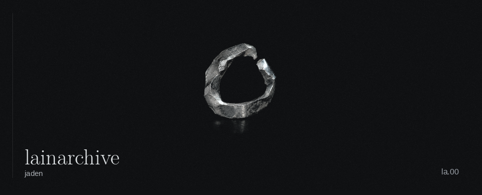
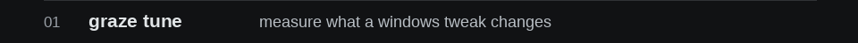
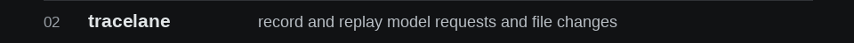
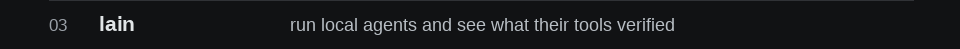
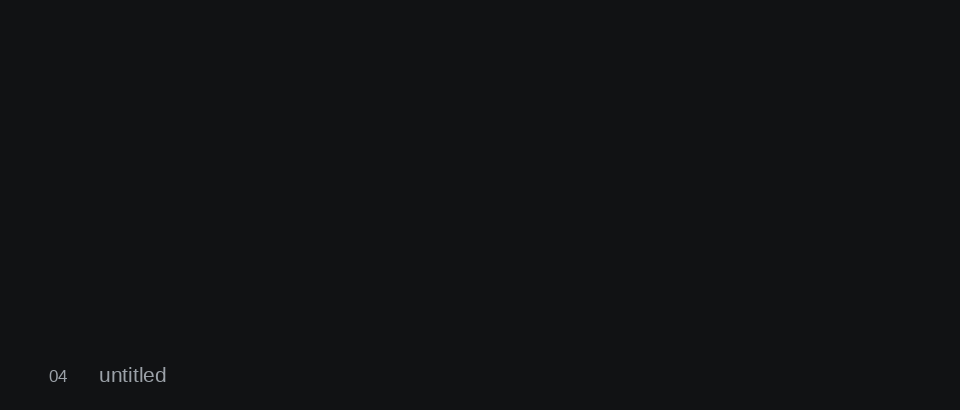

   
  <a href="https://github.com/lainarchive/graze-tune"><picture>
    <source media="(max-width: 600px)" srcset="./assets/track-graze-tune-mobile.png">
    
  </picture></a> 
  <a href="https://github.com/lainarchive/tracelane"><picture>
    <source media="(max-width: 600px)" srcset="./assets/track-tracelane-mobile.png">
    
  </picture></a> 
  <a href="https://github.com/lainarchive/lain"><picture>
    <source media="(max-width: 600px)" srcset="./assets/track-lain-mobile.png">
    
  </picture></a> 
  

